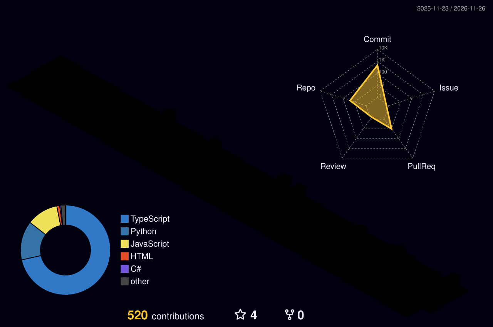

<!-- ============================================================ -->
<!--  HEADER                                                       -->
<!-- ============================================================ -->

<div align="center">


<a href="https://git.io/typing-svg"></a>

<br/>

<a href="https://github.com/obylo98"></a>
<a href="https://committers.top/nigeria"></a>
<a href="https://github.com/obylo98?tab=followers"></a>

<br/>

<a href="https://linkedin.com/in/obinnaa-onyekwere"></a>
<a href="mailto:obinnaonyekwere11@gmail.com"></a>
<a href="https://medium.com/@obylo98"></a>


</div>

<br/>

### 👋 Hey, I'm Obinna

I'm a full-stack engineer and solo product builder who likes owning a product from the first PRD to the production server. Most of what I build sits where **AI, automation and real business workflows** meet: agent platforms, creator tools, voice AI, video pipelines and desktop apps. Before engineering I worked in **IT support and account management**, so I build with the end user and the support queue in mind.

```ts
const obinna = {
  role:       "Senior Software Engineer @ Homie Clean",
  building:   "AI-powered tools for agencies and creators",
  stack:      ["TypeScript", "Next.js", "NestJS", "PostgreSQL", "Python", "Electron"],
  exploring:  ["Cloud & DevOps security", "IaC misconfiguration detection", "CI/CD pipeline security"],
  education:  "B.S. Applied Technology, BYU-Idaho (2026)",
  speaks:     ["English", "Français"],
  offKeyboard:["Football ⚽", "African history", "Storytelling", "Markets 📈"],
};
```

<br/>

### 🛠️ Stack

<p align="left">
  
</p>

<br/>

### 🚀 Featured Work

<table>
  <tr>
    <td width="50%" valign="top">
      <h4>🤖 Sabi</h4>
      <p>An AI-powered platform that helps marketing agencies automate everyday work with intelligent agents and workflows.</p>
      <p><code>TypeScript</code> <code>AI Agents</code> <code>Automation</code></p>
      
    </td>
    <td width="50%" valign="top">
      <h4>🔍 CreatorLens</h4>
      <p>YouTube creator intelligence: niche research, channel analysis and JSON production packets for automated video pipelines. Comes with a web app and a Chrome extension.</p>
      <p><code>Next.js 15</code> <code>Chrome MV3</code> <code>Inngest</code> <code>Turborepo</code> <code>Neon</code></p>
      <a href="https://creatorlens-extension.vercel.app"></a>
    </td>
  </tr>
  <tr>
    <td width="50%" valign="top">
      <h4>🎙️ AI Adaptive Teleprompter</h4>
      <p>A Windows-first desktop teleprompter that follows <i>your voice</i>. Real-time speech-to-script alignment keeps the script in step with you instead of scrolling at a fixed speed.</p>
      <p><code>Electron</code> <code>React</code> <code>TypeScript</code> <code>Speech AI</code></p>
    </td>
    <td width="50%" valign="top">
      <h4>🧹 Service Booking Platform</h4>
      <p>A production booking and invoicing system for a home-services business, built and maintained as part of my engineering role.</p>
      <p><code>Next.js</code> <code>PostgreSQL</code> <code>Python</code></p>
      
    </td>
  </tr>
  <tr>
    <td width="50%" valign="top">
      <h4>🛬 Landit</h4>
      <p>A job search platform with resume tailoring, an AI interview coach and a browser extension, built to help people land their next role.</p>
      <p><code>Next.js</code> <code>React</code> <code>Node.js</code></p>
      <a href="https://landit-red.vercel.app/"></a>
    </td>
    <td width="50%" valign="top">
      <h4>⚽ Sports Live</h4>
      <p>A live match app with real-time scores and match updates.</p>
      <p><code>Next.js</code> <code>React</code> <code>REST APIs</code></p>
      <a href="https://sports-live-web.vercel.app/"></a>
    </td>
  </tr>
</table>

<br/>

### 🧪 More Things I've Built

| Project | What it does | Stack |
|---|---|---|
| **VoiceOS** | Voice AI receptionist SaaS for clinics | `Retell AI` `Telnyx` `Next.js` |
| **AI Forex Analysis System** | Market analysis with backtesting and a signal engine | `Python` |
| **ASTV-Local** | Local script-to-video pipeline: JSON manifest → finished video essay, with a monitoring dashboard | `Remotion` `ElevenLabs` `TypeScript` |
| **Faceless Content Engine** | Niche-aware script-to-video pipeline with swappable AI providers, slideshow/animated/hybrid output modes and character-consistency control | `Python` `AI APIs` |
| **Business Document Suite** | Invoice, waybill and letterhead tools for a goods & services company | `Web` |

<br/>

### 🔨 On the Workbench

- **MailForge AI**: an email marketing platform (NestJS + Next.js)
- **LeadClaw**: AI lead generation with a WhatsApp/Telegram chat interface
- **DocForge**: multi-tenant document generation for small businesses, with AI template extraction (Claude Vision)
- **Football Live Clip Engine**: multi-modal highlight detection for live football streams. Audio, computer-vision and live-commentary signals vote on what counts as a highlight (`Playwright` `FFmpeg`)
- **AI Rubric Assistant**: suggests scores, highlights and rationales for LLM-evaluation work; Gemini reads the screens and Claude does the analysis

<br/>

### 🎓 Education & Certifications

- **B.S. Applied Technology**, BYU-Idaho (2026)
- **A.A.S. Applied Technology**, BYU-Idaho (2025)
- BYU-Idaho certificates: **Web & Computer Programming** · **Web Development** · **Database**
- **Google IT Support** Professional Certificate
- Coursework includes software engineering principles, full-stack web development (WDD 130–430), databases & SQL, Linux and cybersecurity

<br/>

### 🏆 GitHub Stats & Rankings

<div align="center">

<a href="https://github.com/obylo98"></a>
<a href="https://github.com/obylo98"></a>

<a href="https://github.com/obylo98"></a>

</div>

<br/>

<div align="center">
  <a href="https://github.com/ryo-ma/github-profile-trophy"></a>
</div>

<br/>

### 🧊 Contributions in 3D

<div align="center">
  
</div>

<br/>

### 📈 Activity

<div align="center">
  
</div>

<br/>

### 🧬 Deep Metrics

<div align="center">
  
</div>

<br/>

<div align="center">
  <picture>
    <source media="(prefers-color-scheme: dark)" srcset="https://raw.githubusercontent.com/obylo98/obylo98/output/github-contribution-grid-snake-dark.svg" />
    
  </picture>
</div>

<br/>


<div align="center">
  <sub>Building in public from Lagos 🇳🇬 · Open to remote roles and interesting collaborations</sub>
</div>
